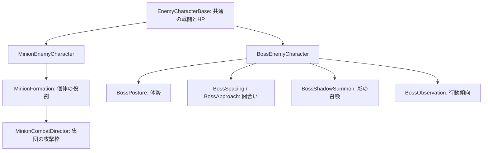
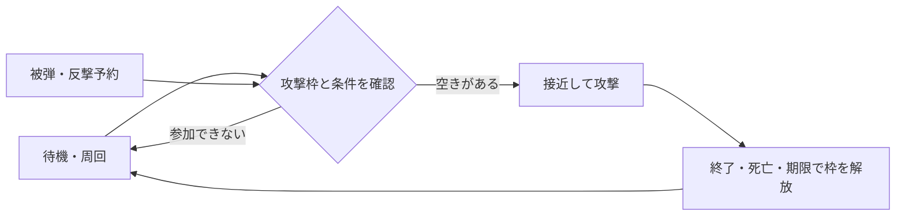
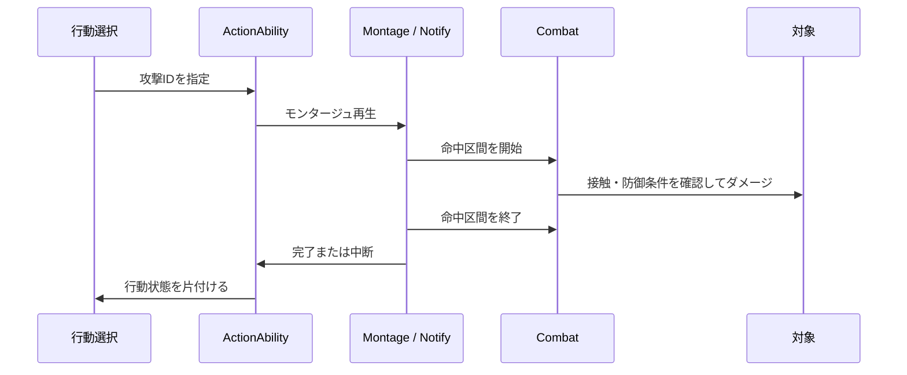

# ECHOES

### 間合い・集団の役割・攻撃の予兆で、緊張感を作る剣戟アクション

チーム制作の剣戟アクションゲームです。このリポジトリでは、私が担当した**雑魚敵・ラストボスの戦闘システム、敵AI、生成管理、アニメーションと命中判定の接続**を紹介します。

敵を強くするだけでなく、プレイヤーが「攻撃を読む・避ける・反撃する」ための間を作ることを目標にしています。判断や状態管理をC++で扱い、攻撃データ・アニメーション・見た目・音はBlueprintや各種アセットで調整する構成です。

**[ゲームをダウンロード](https://github.com/prashant-rayamajhi/ECHOES/releases/latest) · [担当範囲](#担当範囲) · [設計と理由](#技術的に工夫した点と設計理由) · [主要コード](#特に見てほしいコード) · [BP設定](docs/BlueprintSetup.md) · [検証と公開範囲](#検証と公開範囲)**

## 基本情報

| 項目 | 内容 |
| --- | --- |
| ジャンル | 三人称視点の剣戟アクション |
| 制作形態 | チーム制作 |
| 担当 | 敵AI、敵戦闘、ボス、敵生成、敵の演出・UIとの接続 |
| 使用エンジン | Unreal Engine 5.7 |
| 使用言語・環境 | C++、Blueprint、Visual Studio、Windows |
| 主な技術 | Behavior Tree、Blackboard、GAS、AnimMontage、AnimNotify、Navigation、UMG、Niagara |
| 公開内容 | 敵担当部分のC++ソース88ファイル、設計・BP設定資料、Windows Shipping版 |
| 公開ソースの更新日 | 2026年10月31日 |

## 今回の公開範囲

敵担当のソースと資料を公開しています。プレイヤー・分身本体・イベント・共通GASのソース、編集用Contentは含めていません。BPで設定する箇所は資料で説明しています。

2026年10月31日：三項演算子など、途中で改行されていた12か所を1行に整理しました。空白と改行以外の文字が一致することを確認しています。この整形についてゲームの処理は変更していません。

GitHubの「Code → Download ZIP」は閲覧用ソースです。ゲーム実行ファイルや、単体でビルドできる完全なUEプロジェクトではありません。

## Windows版のダウンロード・起動

1. [最新Release](https://github.com/prashant-rayamajhi/ECHOES/releases/latest)のAssetsから、`ECHOES-Windows.zip.001`、`ECHOES-Windows.zip.002`、`Join-ECHOES.cmd`を同じフォルダへ保存します。
2. `Join-ECHOES.cmd`を実行し、作成された`ECHOES-Windows.zip`をすべて展開します。
3. 展開先の`Echoes/Echoes.exe`を起動します。ECHO・Engineフォルダも必要なので、exeだけ移動しないでください。

7-Zipを使う場合は、2つの分割ファイルを揃えて`.001`を開き、直接展開することもできます。結合・展開中は10GB以上の空き容量を目安にしてください。Visual C++ランタイムが必要な場合は、同梱の`Engine/Extras/Redist/en-us/vc_redist.x64.exe`を使用できます。

`SHA256SUMS.txt`はダウンロードしたファイルの照合用です。GitHubの自動生成する「Source code」はゲーム本体ではありません。

## 担当範囲

### 実装・調整した内容

- 雑魚敵の追跡、周回、攻撃担当の調整、被弾した敵の反撃、プレイヤー分身への対応
- 通常攻撃・強攻撃・コンボ・空中攻撃の選択と、モンタージュ再生・命中区間の接続
- ボスのフェーズ移行、間合いの取り直し、体勢ゲージ、影の召喚、包囲への対応
- 敵のガード、受け流し結果への反応、ひるみ、死亡と後片付け
- 雑魚敵・ボスのSpawner、開始トリガー、生成失敗への対応
- 敵HP表示、斬撃・命中・影の演出、音の再生タイミングと距離減衰の調整

### チーム・素材との境界

プレイヤー操作、プレイヤーの分身本体、ステージ進行などはチーム側の実装へ接続しています。このリポジトリにゲーム全体を一人で制作したという意味はありません。外部のモデル・アニメーション・音源を使用しており、素材の制作と、素材をゲームに組み込む実装・調整を区別しています。

実装や調査、資料の整理にはAI支援も使用しています。面談では、コードの役割、採用理由、確認できた範囲と残る課題を分けて説明します。

## 今回の更新

- 最新の敵担当コード88ファイルへ更新しました。
- `EnemyPlayerHistory`を含め、敵側からプレイヤーの攻撃の繰り返し・間隔を記録する処理を公開しています。これはルールによる判断のための記録であり、機械学習ではありません。
- Windows Shipping版を新しく作成し、起動ファイルを`Echoes.exe`にしました。
- フォルダ移動後に古いGameModeを参照していたパッケージ設定を修正しました。プレイヤー側の処理は変更していません。
- 剣と影の斬撃マテリアルの未接続入力を修正し、配布版の代替マテリアル表示を防ぐようにしました。

## 技術的に工夫した点と設計理由

### 1. 敵共通の処理と、ボス特有の処理を分ける

`EnemyCharacterBase`に攻撃の開始条件・終了処理・HP・被弾の入口を置き、雑魚敵とボスが共通で使います。ボスの体勢、影、接近、間合い、観察は、それぞれのコンポーネントへ分けています。

**理由：** 攻撃判定や終了処理の修正を敵ごとに重複させず、ボス固有の機能が共通クラスを大きくし続けることを避けるためです。共通化だけを優先せず、雑魚敵とボスのBTサービスは別クラスにしています。



継承と機能の分担を示す概念図です。すべての矢印がC++の継承を意味するものではありません。

### 2. C++でルールを守り、BPで戦闘を調整する

DataAssetの攻撃ID、モンタージュ、射程、重み、再使用時間などを使い、C++が使用可能な行動を選びます。BPから敵のデータ、BT、音、Niagara、Widgetを設定し、通知の位置はモンタージュ上で調整します。

**理由：** アニメーションを差し替えたり間合いを調整したりするたびに、C++を変更してビルドする負担を減らすためです。ただし、HP表示の補間や通知の処理など、C++側に残している部分もあります。「すべてBPで実装」ではありません。

| C++で扱うもの | BP・アセット側で調整するもの |
| --- | --- |
| 行動条件、状態遷移、重複命中の防止 | 攻撃ID、射程、重み、クールダウン |
| 集団の攻撃枠、反撃予約 | BT・Blackboard、周回距離、移動速度 |
| Notifyで実行する処理 | Montageの区間・通知位置・再生速度 |
| 生成、終了、参照の後片付け | 敵クラス、生成数、出現位置 |
| ダメージと演出をつなぐ通知 | Niagara、Sound、Material、Widget |

### 3. 一対一を軸にしながら、攻撃された敵も反応する

各敵が自由に攻撃すると、一斉攻撃になりやすくなります。そこで対象ごとの攻撃枠を`MinionCombatDirector`で管理し、個体側の`MinionFormation`が参加・周回・離脱を扱います。攻撃された待機中の敵は反撃を予約し、上限とタイミングの条件を満たした場合に追加参加します。

**理由：** 読み合いの余裕を残しながら、出番でない敵を殴っても無反応になる不自然さを避けるためです。常に一体固定、常に全員攻撃という両極端を避け、BP側の設定で人数と間隔を調整できます。



### 4. 攻撃アニメーションと、ダメージが入る区間を合わせる

`BossCombatWindow`で命中区間を開閉し、`Combat`が武器の根元・先端や前フレームからの移動を使って判定します。一振りで同じ対象に何度も当たらないよう命中済みの管理も行います。コンボはセクションの分岐と攻撃IDの接続で扱います。

**理由：** モーションが再生されたことと、実際に攻撃が当たったことを分けるためです。見た目に合わせて通知を動かせるので、攻撃開始時に先に音やエフェクトだけが出る問題も、再生区間と合わせて調整できます。



### 5. ボスの変化を、HPだけではなく行動へ反映する

フェーズ1のHPが0になると最終死亡と区別して移行処理へ入り、攻撃や移動を止め、演出後にフェーズ2の判断を再開します。HPとは別の体勢ゲージを設け、崩れた後の隙と回復も管理します。影の召喚は専用クラスで寿命と対象を管理します。

観察処理は、距離や移動などから行動の重みを調整するルールベースの仕組みです。機械学習で敵が学習する実装ではありません。

**理由：** フェーズ移行・気絶・攻撃中断で状態が混ざると、敵が止まったままになるためです。演出が終わった後に何を再開し、どの状態を解除するかを明確にしています。

### 6. 生成設定を、配置する人が扱える形にする

雑魚敵はSpawnerへクラス、数、範囲、出現地点を設定します。ボスは専用Spawnerと入口のトリガーで開始を管理し、生成位置の確認、再試行、重複開始の防止を行います。

**理由：** 配置担当がC++を読まずに敵の数と位置を調整できるようにするためです。本公開版の主なSpawnerはSpawnActorとDestroyを使います。オブジェクトプールを全面採用した構成ではありません。

## 発生した問題と改善内容

| 問題 | 確認した条件 | 実装した対応 |
| --- | --- | --- |
| 待機中の敵が攻撃されても反応しない | 攻撃担当の保持が反撃の参加を妨げる | 一時的な反撃枠と期限・解放を分離 |
| 分身の攻撃で敵が違う対象を反撃対象にする | Controllerだけでは実際の攻撃者を区別できない | ダメージの原因となったPawnを優先 |
| 攻撃が当たっても演出が揃わない | 命中・ダメージ成立・音の呼び出しが別経路 | 成立したダメージから命中演出へ接続 |
| コンボや中断後に敵が止まる | 完了・中断時の状態解除が揃わない | Abilityの終了経路と時間切れ処理を用意 |
| 剣を振る前に演出が出る | 演出開始とモーションの振りがずれる | Notify区間と武器への追従を調整 |

上記は実装した対応です。すべてのマップ・配置・操作で問題がないという意味ではありません。

## 特に見てほしいコード

| 順番 | ファイル | 見てほしい点 |
| --- | --- | --- |
| 1 | [EnemyCharacterBase.cpp](Source/ECHO/Private/Enemy/Core/EnemyCharacterBase.cpp) | 共通の行動条件、攻撃選択、被弾の入口 |
| 2 | [EnemyData.h](Source/ECHO/Public/Enemy/Core/EnemyData.h) | BPで調整する攻撃データ |
| 3 | [MinionCombatDirector.cpp](Source/ECHO/Private/Enemy/Minion/MinionCombatDirector.cpp) | 対象ごとの攻撃枠と反撃の参加 |
| 4 | [Combat.cpp](Source/ECHO/Private/Enemy/Combat/Combat.cpp) | 命中区間、武器の接触、重複命中の防止 |
| 5 | [ActionAbility.cpp](Source/ECHO/Private/Enemy/Abilities/ActionAbility.cpp) | モンタージュ完了・中断と後片付け |
| 6 | [BossEnemyCharacter.cpp](Source/ECHO/Private/Enemy/Boss/BossEnemyCharacter.cpp) | フェーズ移行と共通処理との接続 |
| 7 | [BossShadowSummon.cpp](Source/ECHO/Private/Enemy/Boss/BossShadowSummon.cpp) | 召喚条件、対象、寿命管理 |
| 8 | [MinionSpawner.cpp](Source/ECHO/Private/Enemy/Spawning/MinionSpawner.cpp) | 配置設定と生成失敗への対応 |

## リポジトリ構成

```text
Source/ECHO/Public, Private/
├─ Enemy/
│  ├─ Core/        敵共通の戦闘とデータ
│  ├─ AI/          Controller・BTサービス・対象選択
│  ├─ Minion/      雑魚敵と集団の役割
│  ├─ Boss/        ボス・体勢・観察・影
│  ├─ Combat/      攻撃・防御・弾・命中演出
│  ├─ Abilities/   GASの行動実行
│  ├─ Animation/   通知・残像・斬撃の接続
│  ├─ Spawning/    生成と開始トリガー
│  ├─ Audio/       敵の音
│  └─ UI/          HP表示との接続
（共通Combat/GASは公開対象外。依存先はdocsに記載）
docs/              BP設定・依存先・公開ファイルの記録
```

## 検証と公開範囲

- 2026年10月31日の元プロジェクトで、EditorビルドとWindows Shippingパッケージの作成成功を確認しています。
- 集団戦の限定テストで、主担当の維持、反撃による2体目の参加、3体目の待機、反撃枠の解放と次の参加を確認しました。
- 今回はソースの整形です。空白・改行以外の変更がないことを確認しています。全編通しプレイ・全攻撃・全GPU環境での動作を保証するものではありません。
- ソースは閲覧用の抜粋です。**このリポジトリ単体ではビルドできません。** 未公開のチーム実装やBPへの依存は[Dependencies.md](docs/Dependencies.md)に記載しています。
- BP、モンタージュ、モデル、マップなどの編集用アセットは含めていません。実行用のCook済みデータはReleaseに含めています。
- 公開コードは元ファイルの処理を変えず、閲覧用に文字コードをUTF-8へ統一しています。[ファイル記録](docs/source-manifest.json)に元ファイルと公開ファイルのハッシュを残しています。

### 今後の改善

攻撃の読みやすさ、集団の参加間隔、横移動時の足滑りは、実際の戦闘を見ながら調整を続ける項目です。プレイヤー固有クラスへの依存は残っており、チーム間の接続を小さなインターフェースへ整理する余地があります。観察項目も、取得している値が実際の選択へ使われているかを点検し、仕様と実装のずれを減らしていきます。

## クレジット・取り扱い

ECHOESはチーム制作作品です。ここでは敵担当の実装を紹介しています。Unreal Engineおよび使用した外部素材の権利はそれぞれの権利者に帰属します。素材の再配布や商用利用を許諾するものではありません。本リポジトリに新たなオープンソースライセンスは付与していません。
