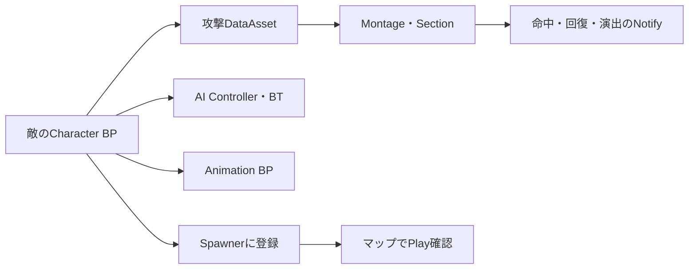

# BPでの設定と確認手順

これは元プロジェクトでの設定場所を説明する資料です。公開リポジトリには以下の編集用アセットを含めていません。

## 設定を読む順番

## 1. 敵の本体

- ボス：`/Game/Enemy/Boss/Production/BP_Boss`
- 影：`/Game/Enemy/Boss/Production/Shadow/BP_BossShadow`
- 雑魚敵：`/Game/Enemy/Minions/` 内のMelee、Super、White、Prime各BP

Character BPでMesh、Anim Class、AI Controller、Behavior Tree、攻撃データを確認します。剣の見た目は装備先ソケット、命中判定は剣の根元と先端のソケットを扱うため、取り付け用と判定用を混同しないことが重要です。

## 2. 攻撃とアニメーション

ボスの攻撃設定は`/Game/Enemy/Boss/Production/Data/DA_Boss`、影は`Shadow/DA_BossShadow`です。ActionsにID、Montage、Kind、距離、重み、再使用時間などを設定し、フェーズ別の使用IDと揃えます。

Montageでは次を確認します。

1. Slot名がAnimBP側と一致しているか。
2. 攻撃区間に`BossCombatWindow`があるか。剣を振る前から区間を開いていないか。
3. コンボのSection名と`BossComboRoute`の分岐先が一致しているか。
4. `BossRecovery`による終了位置が命中区間より前になっていないか。
5. 斬撃、音、残像の通知がモーションと合っているか。

通知クラスはC++で処理を実装し、配置と長さはMontage上で編集します。終了通知だけでなく中断時の処理も確認します。

## 3. AIと集団戦

ボスは`/Game/Enemy/Boss/Production/AI/BT_Boss`、雑魚敵は`/Game/Enemy/Minions/AI/BT_Minion`を確認します。専用の`BossUpdateCombat`と`MinionUpdateCombat`で判断を更新します。

雑魚敵のFormationでは周回・移動・反撃に関する調整値を扱います。攻撃担当だけでなく、待機中の敵を攻撃した場合、担当が死んだ場合、分身が現れた場合も確認してください。攻撃枠は上限を設け、被弾した全員が同時に突撃することを避けます。

## 4. Spawner

| 種類 | BP | 主な設定 |
| --- | --- | --- |
| 雑魚敵 | `/Game/Enemy/Minions/Spawning/BP_MinionSpawner` | 敵クラス、数、半径、出現地点、開始方法、NavMesh条件 |
| ボス | `/Game/Enemy/Boss/Production/BP_BossSpawner` | ボスBP、生成地点、入口トリガー、開始・リセット |

レベルへSpawnerを配置し、出現地点を壁や床の中に入れないようにします。NavMeshが必要な設定では、出現地点と追跡先が到達可能か確認します。直接配置した敵とSpawnerの敵を重複させないでください。

生成失敗時はログと位置を確認します。生成数だけを増やして解決しようとせず、衝突・NavMesh・プレイヤーとの距離条件を確認します。

## 5. UI・音・演出

ボスHUDは`/Game/Enemy/Boss/Production/UI/WBP_BossHUD`を入口に確認します。敵UIには`/Game/Enemy/UI/`のWidgetも使います。通常HPと体勢の表示・回復・崩れの状態は別です。

敵のAudioコンポーネントへ音を割り当て、距離減衰は`/Game/Enemy/Audio/SA_Enemy`などの設定で調整します。NiagaraとMaterialはBP・通知から参照し、プレイヤーの攻撃方向や敵の輪郭を隠しすぎないように調整します。

## Playで見るポイント

- 敵が射程まで近づき、攻撃を開始しているか。
- 剣が当たる瞬間とHP・音・エフェクトが一致しているか。
- 一振りで同じ相手に多重ダメージが出ていないか。
- 攻撃完了・中断・ガード崩し・フェーズ移行後に行動が再開するか。
- 主担当、待機敵の反撃、分身への対応が上限内に収まるか。
- 死亡・リセット・マップ終了後に敵や影が残り続けないか。

この資料は設定箇所と確認手順を示します。全項目が最新パッケージで検証済みという意味ではありません。

## 2026年11月12日：影が出ない場合の確認

本番マップは `/Game/Level/Gothic_Cathedral_WP` です。影はボスの近くに安全な床がある場合に生成します。

1. `BP_Boss` の Shadow Summonで、影クラス・召喚対象数・連携用の攻撃ID・待ち時間を確認します。
2. Play中の `Spawn State` を確認します。`NoShadowClass` は影BP未設定、`NoSafeFloor` は安全な床が見つからない状態、`Cooldown` は待ち時間です。
3. 本番マップではRecastNavMeshの `Runtime Generation` を `Dynamic` にしています。出現位置と追跡先に歩ける床が作られることを確認します。
4. 連携する攻撃は `Join Moves` に登録します。条件に合う攻撃がない場合は `WaitingForJoinMove` で待機します。
5. 元プロジェクトのBP設定値が実際の設定です。C++に記載した初期値とBPの値は異なることがあります。

影の移動・交代の安全確認はC++で行い、使用クラス・モンタージュ・音・演出と調整値はBP／アセット側で設定します。
