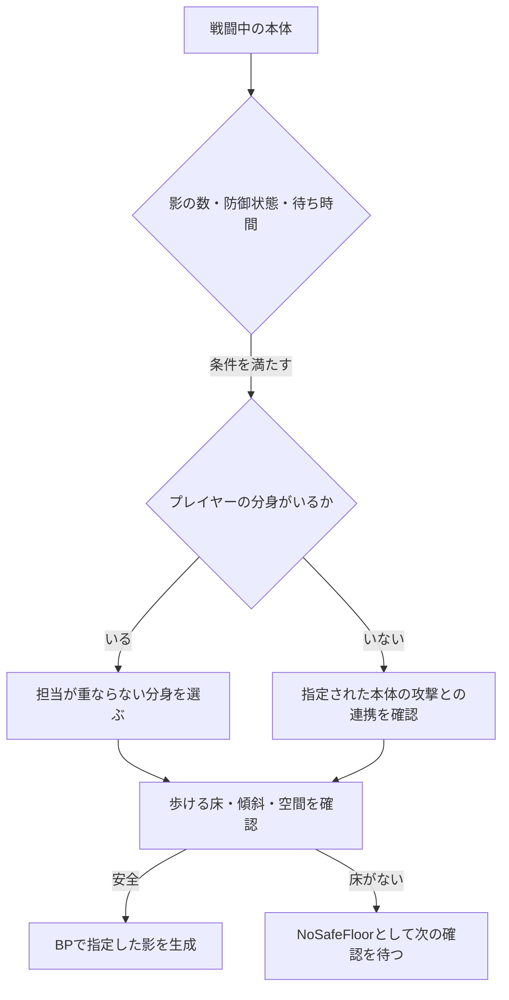

# ECHOES 更新記録 — 2026年11月12日

元プロジェクトのコミット `d6f764d46238fdceda8df41b0796b10bcdcc17e0` を基に、敵担当ソースとWindows版を更新しました。元リポジトリのmainとローカルのHEADが一致していることも確認しました。

## 最新コードで変わった点

| 処理 | 実装の役割 | 設定する場所 |
| --- | --- | --- |
| BossShadowSummon | 歩ける床と体の入る空間を調べ、影を生成する。分身の対象が重ならないように選ぶ | BP_BossのShadow Summon |
| BossShadowStep | 攻撃・抜刀・退避中を避けて交代を判断し、着地点・帰路の安全を確認する | 同コンポーネントの交代関連設定 |
| BossUpdateCombat | 見失った相手の最後の位置へ近づく。全経路が取れない時は途中の到達可能な床を探す | 専用BTサービス、Navigation |
| Combat / EnemySwing | ダメージ区間と剣の動きを使って命中・斬撃を接続する | 攻撃データ、MontageのBossCombatWindow |
| BossBladeTrail | 旧Montageとの互換性のために残している目印。現在の斬撃開始処理はここでは行わない | 斬撃はBossCombatWindowのDamage区間で設定 |

影が出ない時に理由を調べられるよう、`Spawn State`を公開しています。安全な床がない場合に無理に生成するのではなく、設定・床・待ち時間のどこで待っているかを確認できます。

## 検証記録の扱い

元プロジェクトに保存された11月12日のUEエディタPlay記録では、再起動後の本番マップで影の自然召喚と、最大2体の影がそれぞれプレイヤーの分身へ向かう動作が確認されています。本番マップは`Gothic_Cathedral_WP`、RecastNavMeshは`Dynamic`設定です。

これは元プロジェクトの既存Play検証記録です。今回作り直したShipping版で、すべての戦闘を再検証したという意味ではありません。

今回の再ビルドではEditor Development・Windows Shippingの両方が成功し、Cook・Stage・Package・Archiveも終了コード0で完了しました。Cookはエラー0件、警告19件です。既存のCollision Profileの`Cmara`未定義とTextureのDownscale設定に関する警告は残っています。C++にはプレイヤー側の初期化順序や旧APIに関する警告もあります。今回、担当外コードを変更して警告を消すことはしていません。

## 公開範囲

敵担当の91ファイルを掲載しています。新たに追加した3ファイルも敵の処理です。プレイヤー本体、分身本体、イベント、共通GASのソースは含めません。実行用Releaseには、ゲーム全体を動かすCook済みデータを含めます。

コードは閲覧用にUTF-8・LFへ統一しています。ゲームのロジックを公開用に書き換えてはいません。元ファイルと公開ファイルの照合値は`source-manifest.json`に記録しています。
